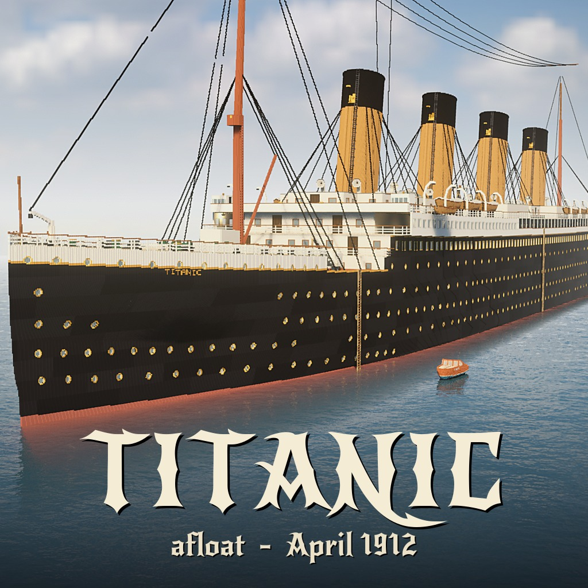

# Titanic - afloat, April 1912

On the Steam Workshop: [Titanic](https://steamcommunity.com/sharedfiles/filedetails/?id=3835599576)

RMS Titanic on her maiden voyage: the whole ship at sea, rebuilt deck by deck from the 1911 builders' plans, with roomier corridors and doorways so you can explore her from the boat deck to the engine room.

## Explore
- The **boat deck** with its lifeboats, the **Grand Staircase** and its dome, the promenades and the public rooms.
- **Cabins of all three classes**, every one with its own door.
- Down below: the **boiler rooms**, the **engine room** and the turbine room. Stairs lead down from F deck, and the firemen's passage runs from the forward holds to the boiler rooms.
- Small boats moored alongside, and rope ladders down the hull if you go overboard.

## Sound the whistle
Pull the whistle cord in the wheelhouse, next to the helm: everyone on the map hears the ship's whistle, louder the closer they are.

## Weather
The host can change the weather in the pause menu (Change weather), including a **Dark night**: a clear, moonless night, as on 14 April 1912, when the ship's lamps and your flashlight light the way.

## Multiplayer
Made for exploring with friends.

Looking for the wreck? [Titanic Wreck](https://steamcommunity.com/sharedfiles/filedetails/?id=3833158777) is the same ship, 60 m down.

## Install

Subscribe on the [Steam Workshop](https://steamcommunity.com/sharedfiles/filedetails/?id=3835599576), or clone this repository into
`Documents/Teardown/mods/titanic`. Play it from the **Mod manager** (Local files), or host it in multiplayer.

## Credits

Made by AgeOfAlgorithms and Claude (Anthropic). MIT licence.
